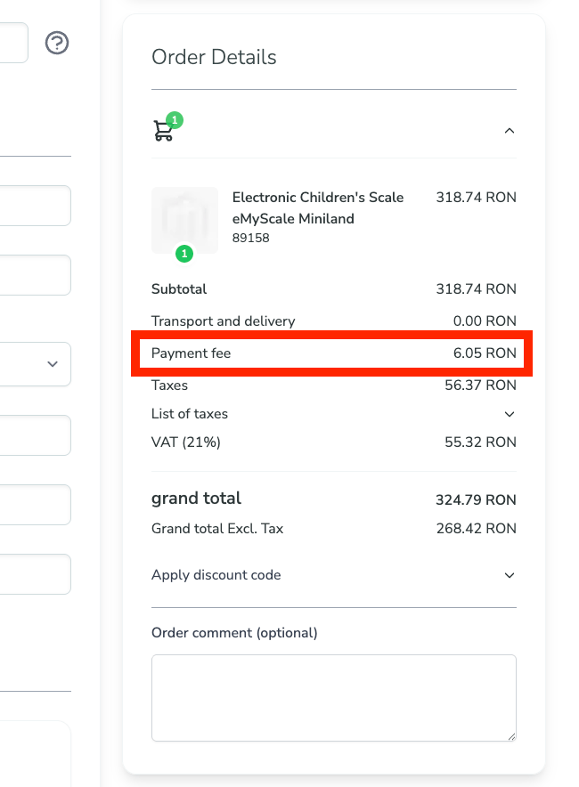

# Liquidlab_HyvaMagePrincePaymentFee

Hyvä Checkout compatibility module for **MagePrince Payment Fee** (`mageprince/magento2-paymentfee`).

## Problems Solved

1. **Invisible Tax in Hyvä Checkout**: The MagePrince Payment Fee module calculates and stores the payment fee tax in the quote, but doesn't expose it as a separate line item in the checkout summary, making it "invisible" to customers.

2. **Missing REST API Support**: The MagePrince Payment Fee module doesn't expose payment fee attributes via REST API (missing `extension_attributes.xml`), preventing headless/API-based checkout implementations from accessing these values.

## Solution

This module provides:
- ✅ **Payment Fee Tax visibility** as a dedicated line item in the Hyvä Checkout price summary
- ✅ **REST API support** by adding extension attributes and plugins for Cart (Quote) and Order entities



## Features

- ✅ Displays Payment Fee Tax as a separate line item under the subtotal in Hyvä Checkout
- ✅ Exposes payment fee attributes via REST API for headless/API-based implementations
- ✅ Only shows when payment fee tax is enabled and has a value > 0
- ✅ Fully integrated with MagePrince Payment Fee module
- ✅ Multi-language support (English & Romanian included)
- ✅ No modifications to vendor code - clean, upgrade-safe implementation

## Requirements

- PHP >= 8.1
- Magento 2.4.x
- **mageprince/magento2-paymentfee** - The base payment fee module
- **hyva-themes/magento2-hyva-checkout** - Hyvä Checkout

## Installation
### Composer Installation

```bash
composer require liquidlab-agency/hyva-mageprince-paymentfee
php bin/magento module:enable Liquidlab_HyvaMagePrincePaymentFee
php bin/magento setup:upgrade
php bin/magento cache:clean
```

## How It Works

1. **MagePrince Payment Fee** calculates the payment fee and tax during quote totals collection
2. It stores the tax amount in `$total->setPaymentFeeTax($tax)` but doesn't return it as a segment
3. **This module** creates a custom total collector that:
   - Doesn't recalculate anything (MagePrince already did that)
   - Simply exposes the `payment_fee_tax` segment via the `fetch()` method
   - Returns the tax amount stored by MagePrince
4. **Hyvä Checkout** picks up this segment and renders it using our custom template
5. The template displays "Payment Fee Tax" as a line item with the formatted tax amount

## Technical Details

### Module Structure

```
app/code/Liquidlab/HyvaMagePrincePaymentFee/
├── composer.json
├── README.md
├── registration.php
├── etc/
│   ├── module.xml
│   ├── sales.xml
│   ├── di.xml
│   └── extension_attributes.xml
├── i18n/
│   ├── en_US.csv
│   └── ro_RO.csv
├── Model/
│   └── Total/
│       └── PaymentFeeTax.php
├── Plugin/
│   └── Sales/
│       ├── AddPaymentFeeToOrder.php
│       └── AddPaymentFeeToCart.php
└── view/
    └── frontend/
        ├── layout/
        │   └── hyva_checkout_components.xml
        └── templates/
            └── checkout/
                └── price-summary/
                    └── total-segments/
                        └── payment_fee_tax.phtml
```

### Key Components

**Hyvä Checkout Integration:**
- **Model/Total/PaymentFeeTax.php** - Total collector that exposes the tax segment for display
- **view/frontend/layout/hyva_checkout_components.xml** - Injects the template into Hyvä Checkout
- **view/frontend/templates/.../payment_fee_tax.phtml** - Displays the tax line item

**REST API Integration:**
- **etc/extension_attributes.xml** - Declares extension attributes for Cart and Order APIs
- **Plugin/Sales/AddPaymentFeeToOrder.php** - Populates payment fee data in Order REST API responses
- **Plugin/Sales/Cart/AddPaymentFeeToCart.php** - Populates payment fee data in Cart REST API responses
- **etc/di.xml** - Registers the plugins

**Configuration:**
- **etc/sales.xml** - Registers the total collector (sort_order: 501, after MagePrince's 500)
- **etc/module.xml** - Module dependencies

### Dependencies

The module loads in this order:
1. `Magento_Sales` - Core sales functionality
2. `Magento_Quote` - Quote management
3. `Mageprince_Paymentfee` - Calculates the payment fee tax
4. `Hyva_Checkout` - UI framework
5. `Liquidlab_HyvaMagePrincePaymentFee` - Displays the tax (this module)

## Compatibility

- **Magento**: 2.4.x
- **PHP**: 8.1+
- **Hyvä Themes**: Compatible with Hyvä Checkout
- **MagePrince Payment Fee**: All versions that support tax calculation

## Support

For issues, questions, or contributions:
- **Developer**: LiquidLab Agency
- **Website**: https://liquidlab.ro
- **Email**: contact@liquidlab.ro

## License

Proprietary - Copyright © LiquidLab Agency. All rights reserved.

## Credits

- Developed by **LiquidLab Agency**
- Compatible with **MagePrince Payment Fee** module
- Built for **Hyvä Checkout**
